<a href="https://kingvic.xyz">
  <picture>
    <source media="(prefers-color-scheme: dark)" srcset="assets/banner-dark.svg">
    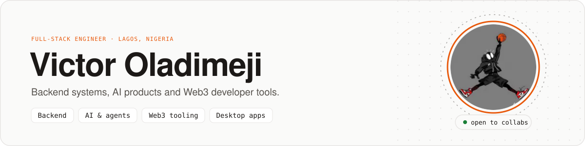
  </picture>
</a>

<br>

<picture>
  <source media="(prefers-color-scheme: dark)" srcset="assets/intro-dark.svg">
  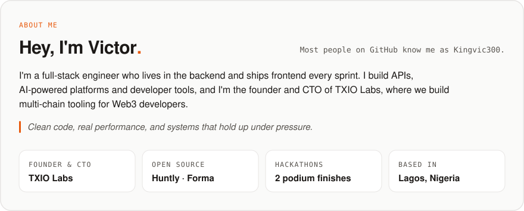
</picture>

<p align="center">
  <a href="https://kingvic.xyz"></a>
  <a href="https://www.linkedin.com/in/victor-oladimeji-a5a68428b/"></a>
  <a href="https://x.com/king_vic07"></a>
  <a href="mailto:victor7ishola@gmail.com"></a>
  <a href="https://github.com/txio-labs"></a>
  <a href="https://github.com/Kingvic300?tab=followers"></a>
</p>

## What I do

<p>
  <picture><source media="(prefers-color-scheme: dark)" srcset="assets/cards/focus-backend-dark.svg">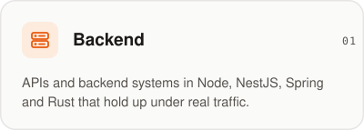</picture>
  <picture><source media="(prefers-color-scheme: dark)" srcset="assets/cards/focus-ai-dark.svg">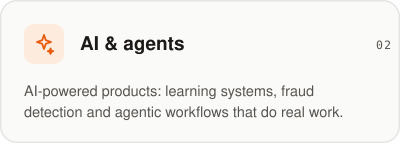</picture>
  <picture><source media="(prefers-color-scheme: dark)" srcset="assets/cards/focus-web3-dark.svg">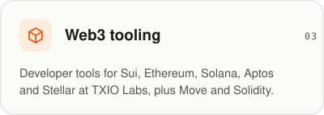</picture>
  <picture><source media="(prefers-color-scheme: dark)" srcset="assets/cards/focus-desktop-dark.svg">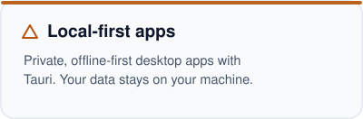</picture>
</p>

## What I'm building

<p>
  <a href="https://sovra-ecru.vercel.app"><picture><source media="(prefers-color-scheme: dark)" srcset="assets/cards/project-sovra-dark.svg">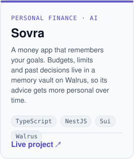</picture></a>
  <a href="https://www.usestakesync.xyz/"><picture><source media="(prefers-color-scheme: dark)" srcset="assets/cards/project-stakesync-dark.svg">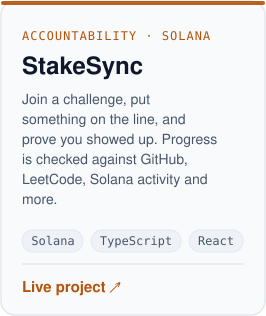</picture></a>
  <a href="https://headwayhq.xyz"><picture><source media="(prefers-color-scheme: dark)" srcset="assets/cards/project-headway-dark.svg">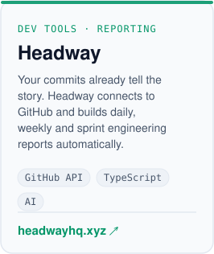</picture></a>
</p>

## Building at TXIO Labs

<a href="https://grantfox.xyz">
<picture>
  <source media="(prefers-color-scheme: dark)" srcset="assets/grantfox-dark.svg">
  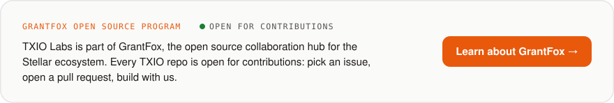
</picture>
</a>

<p>
  <a href="https://txio.xyz"><picture><source media="(prefers-color-scheme: dark)" srcset="assets/cards/project-txio-dark.svg">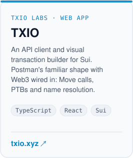</picture></a>
  <a href="https://github.com/txio-labs/txio-cli"><picture><source media="(prefers-color-scheme: dark)" srcset="assets/cards/project-txio-cli-dark.svg">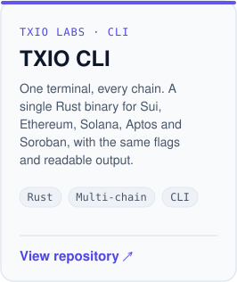</picture></a>
  <a href="https://txio-labs.github.io/txio-desktop/"><picture><source media="(prefers-color-scheme: dark)" srcset="assets/cards/project-txio-desktop-dark.svg">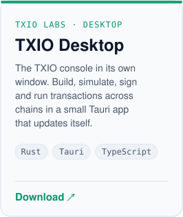</picture></a>
</p>

<p>
  <a href="https://github.com/txio-labs/txio-backend"><picture><source media="(prefers-color-scheme: dark)" srcset="assets/cards/repo-txio-backend-dark.svg">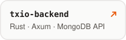</picture></a>
  <a href="https://github.com/txio-labs/txio-sdk"><picture><source media="(prefers-color-scheme: dark)" srcset="assets/cards/repo-txio-sdk-dark.svg">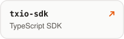</picture></a>
  <a href="https://github.com/txio-labs/txio-telegram-bot"><picture><source media="(prefers-color-scheme: dark)" srcset="assets/cards/repo-txio-telegram-bot-dark.svg">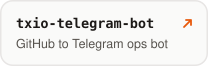</picture></a>
  <a href="https://github.com/txio-labs"><picture><source media="(prefers-color-scheme: dark)" srcset="assets/cards/repo-txio-all-dark.svg"></picture></a>
</p>

## Open source

<p>
  <a href="https://github.com/Kingvic300/Huntly"><picture><source media="(prefers-color-scheme: dark)" srcset="assets/cards/oss-huntly-dark.svg">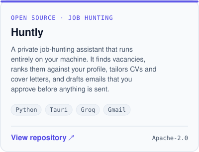</picture></a>
  <a href="https://kingvic300.github.io/Forma/"><picture><source media="(prefers-color-scheme: dark)" srcset="assets/cards/oss-forma-dark.svg">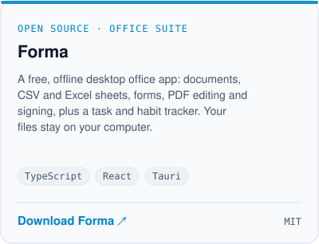</picture></a>
</p>

<picture>
  <source media="(prefers-color-scheme: dark)" srcset="assets/oss-stats-dark.svg">
  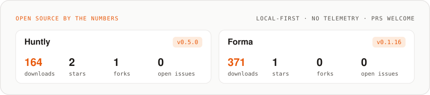
</picture>

<sub>Numbers refresh hourly from GitHub. Both apps are local-first: no telemetry, and your data stays on your computer.</sub>

## Hackathons

<p>
  <picture><source media="(prefers-color-scheme: dark)" srcset="assets/cards/hack-digitaldrive-dark.svg">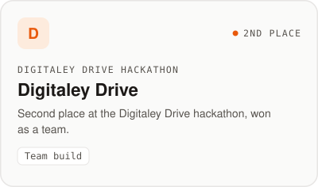</picture>
  <picture><source media="(prefers-color-scheme: dark)" srcset="assets/cards/hack-ecx-dark.svg"></picture>
</p>

## Experience

<picture>
  <source media="(prefers-color-scheme: dark)" srcset="assets/experience-dark.svg">
  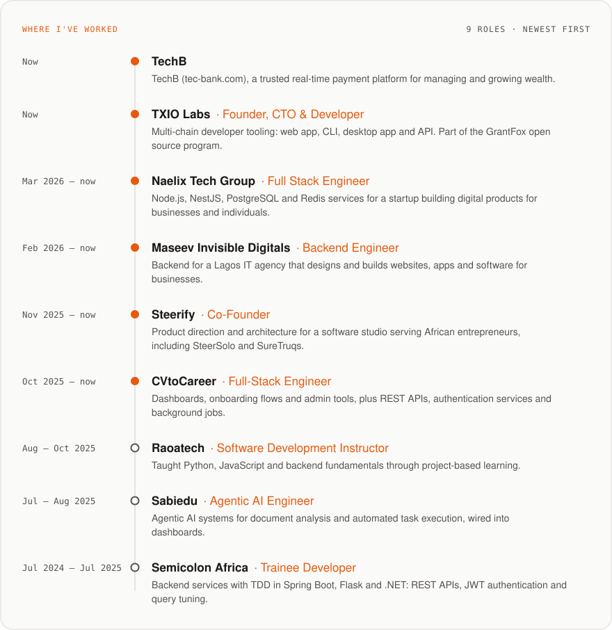
</picture>

<p>
  <a href="https://tec-bank.com/"><picture><source media="(prefers-color-scheme: dark)" srcset="assets/links/techb-dark.svg"></picture></a>
  <a href="https://github.com/txio-labs"><picture><source media="(prefers-color-scheme: dark)" srcset="assets/links/txio-dark.svg"></picture></a>
  <a href="https://cvtocareer.com"><picture><source media="(prefers-color-scheme: dark)" srcset="assets/links/cvtocareer-dark.svg"></picture></a>
  <a href="https://semicolon.africa"><picture><source media="(prefers-color-scheme: dark)" srcset="assets/links/semicolon-dark.svg"></picture></a>
  <a href="https://kingvic.xyz/experience"><picture><source media="(prefers-color-scheme: dark)" srcset="assets/links/history-dark.svg"></picture></a>
</p>

## Recently shipped

<picture>
  <source media="(prefers-color-scheme: dark)" srcset="assets/activity-dark.svg">
  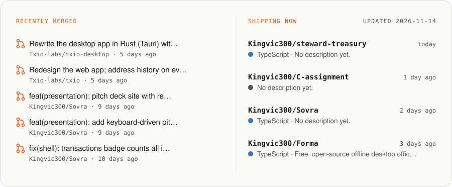
</picture>

<sub>Pulled from public GitHub activity and refreshed hourly.</sub>

## Tech stack

<picture>
  <source media="(prefers-color-scheme: dark)" srcset="assets/stack-dark.svg">
  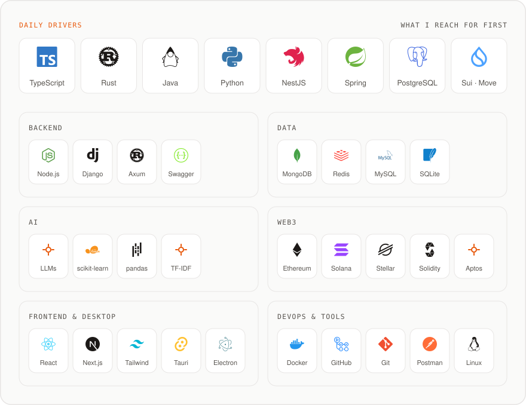
</picture>

## Behind the commits

<picture>
  <source media="(prefers-color-scheme: dark)" srcset="assets/stats-dark.svg">
  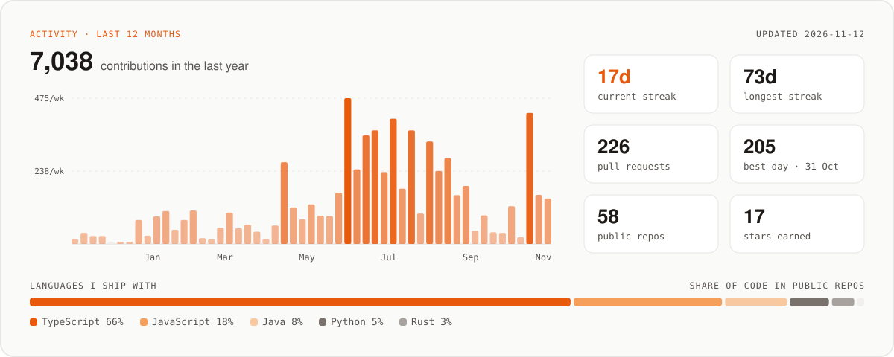
</picture>

<sub>Built from my GitHub contribution data (private contributions included, as on my profile graph) and refreshed hourly by a small GitHub Action in this repo.</sub>

## Contribution snake

<picture>
  <source media="(prefers-color-scheme: dark)" srcset="https://raw.githubusercontent.com/Kingvic300/Kingvic300/output/github-snake-dark.svg">
  
</picture>

## Buy me a coffee ☕

If my tools saved you time, you can buy me a coffee. GitHub Sponsors works, or send a tip in crypto to any address below (click the copy button on each block).

<p>
  <a href="https://github.com/sponsors/Kingvic300"></a>
</p>


```text
GD6ERGKBPEZJG52DJ2N24RIPX3F3BPJ4UUBCJLS763L2JXBHJQWVU6KZ
```


```text
0x10735ec3c80f136c482c694d5cba775ee1ac7f971686fcd3d47f3f0175e5ff8b
```


```text
bc1qrfpkjhm30sfupxa3d597svwz9k8747syrl3xx3
```


```text
0xf384A807E892733E8265747CdcC9928a2cD06a76
```


```text
3hbCiggYJpn2F2nswJFu6hHZqwdDUZWW23K3brRe6Kkk
```

## Let's build something

I'm always up for a good problem: backend systems, AI workflows, or Web3 developer tooling. If you have an idea worth shipping, want to contribute to TXIO, Huntly or Forma, or just want to trade notes, my inbox is open.

<p align="center">
  <a href="https://kingvic.xyz"></a>&nbsp;
  <a href="https://www.linkedin.com/in/victor-oladimeji-a5a68428b/"></a>&nbsp;
  <a href="mailto:victor7ishola@gmail.com"></a>&nbsp;
  <a href="https://x.com/king_vic07"></a>&nbsp;
  <a href="https://github.com/txio-labs"></a>&nbsp;
  <a href="https://github.com/sponsors/Kingvic300"></a>
</p>

<p align="center">
  
</p>

<p align="center"><i>Building real products that scale, one commit at a time ⚡</i></p>
